# Intercompany Transfer Pricing Hub

**Enterprise financial operations demo · Transfer Pricing · Data & Process Automation**

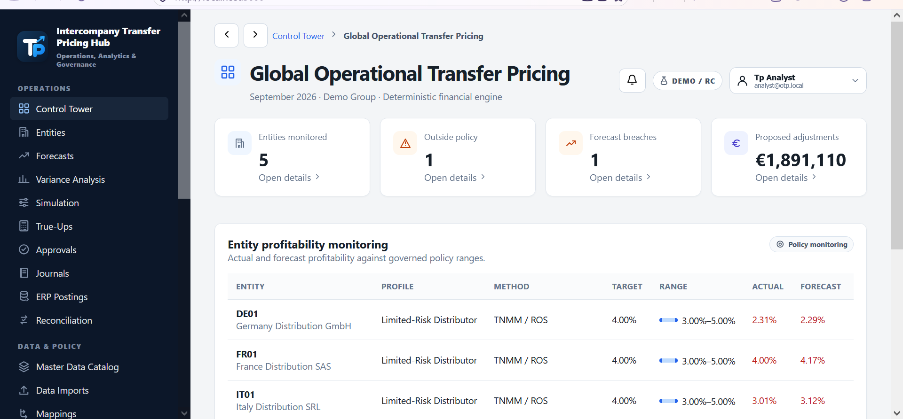

### Login & role-based demonstration

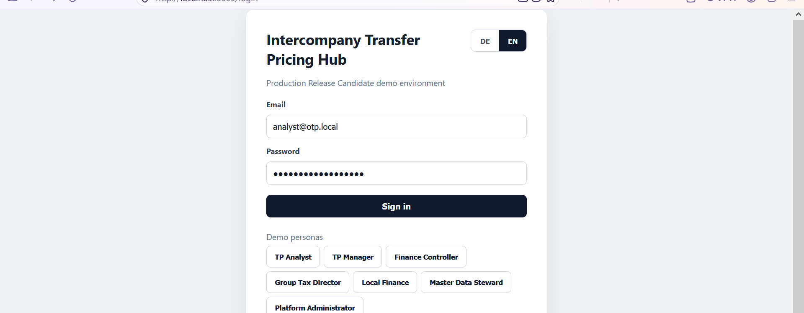

*Screenshot from a successful local demo. Persona selection in this demonstration pre-fills synthetic credentials; these accounts must never be used to secure a public deployment.*

### Application screenshots (local demo, October 2026)

| Forecast analysis — light theme | Forecast analysis — dark theme |
|---|---|
| 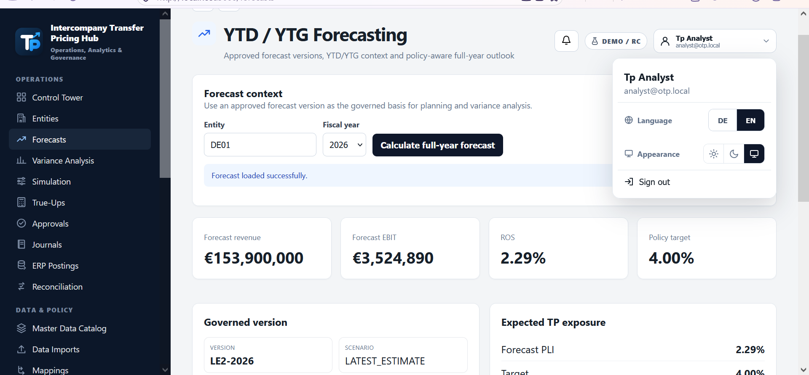 | 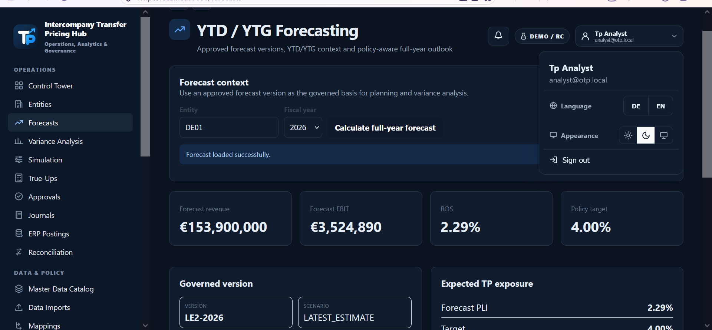 |

| German localization | Controlled true-up workflow |
|---|---|
| 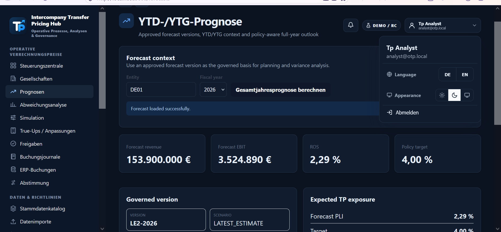 | 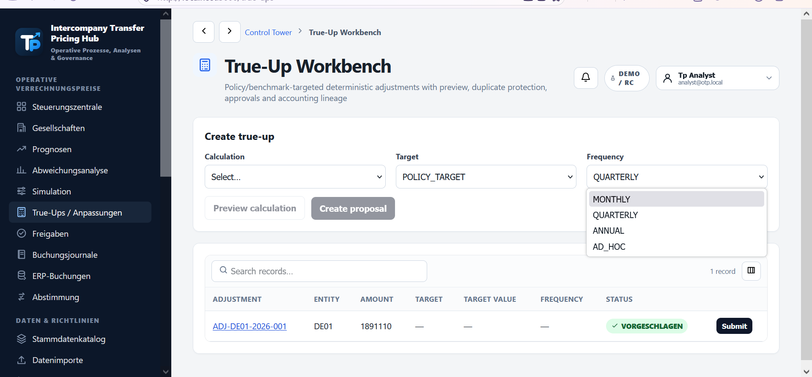 |

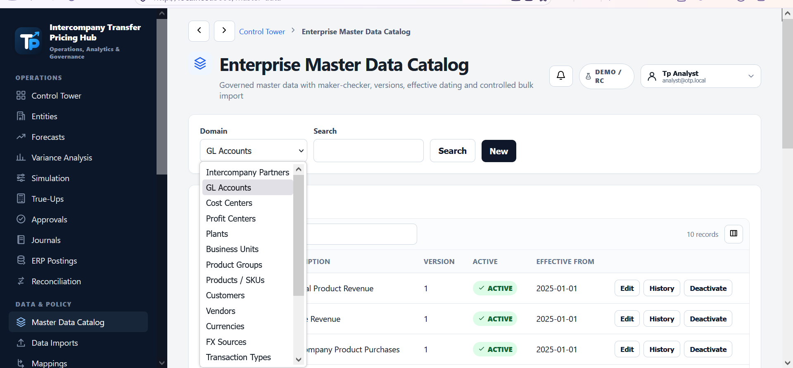

### ERP-to-profitability workflow (actual local demonstration)

| ERP/finance ingestion | Governed ERP-to-TP mapping |
|---|---|
| 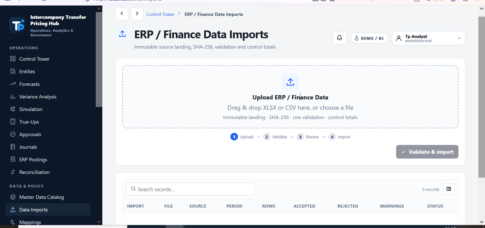 | 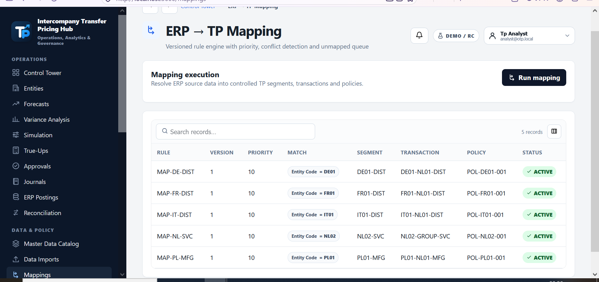 |

| Intercompany cost allocation | Segmented profitability / P&L |
|---|---|
| 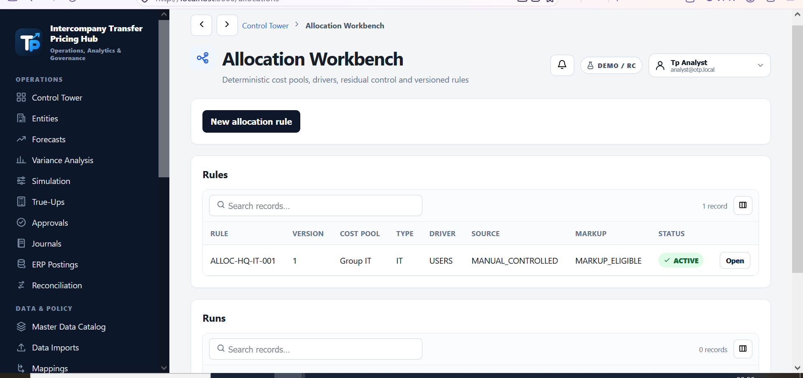 | 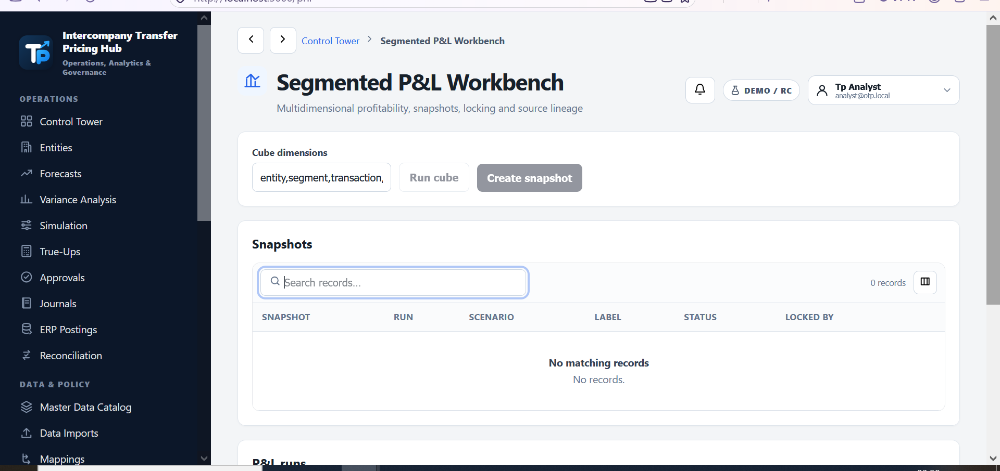 |

*Import and P&L screenshots show empty demo datasets; they do not imply a successful import or P&L run. The new release adds clearer prerequisite guidance to these screens.*


*Screenshots show a running local demo prior to this additional localization/layout polish. All financial figures are demonstration data.*


A full-stack **portfolio demonstration** of how multinational finance and tax teams can manage intercompany transactions through auditable, data-driven workflows. The application combines financial data quality, transfer-pricing policy, profitability monitoring and operational close controls in a single interface.

> **Status:** v2.4.0-rc.3-hotfix7 (branded portfolio edition) — internal release candidate. **Not a production-certified financial or tax solution.** Built for educational/demonstration purposes with synthetic data and a simulated ERP integration.

## Business problem

Intercompany pricing often involves disconnected spreadsheets, manual entity-level profit reviews, separate approval chains and reconciliation evidence. This project demonstrates a governed workflow from imported ERP/GL records to proposed adjustments and journal preparation.

## Featured capabilities

| Area | Demonstrated workflow |
|---|---|
| Data & governance | Entity master, quality validation, CSV/XLSX imports, mapping and approvals |
| Financial analysis | P&L, intercompany cost allocation, benchmark policy and margin monitoring |
| Planning | YTD/YTG forecast, deterministic variance analysis and price simulation |
| Operational TP | True-up calculation, segregation of duties and journal preparation |
| Integration | Simulated ERP posting, reconciliation, evidence and n8n orchestration |
| UX | Branded TP Arrow Mark, responsive navigation and German/English interface |

## Technology

**Frontend:** Next.js 15, React 19, TypeScript · **Backend:** FastAPI, Python · **Data:** PostgreSQL, Redis, MinIO · **Automation:** n8n · **Environment:** Docker Compose, Windows launcher.

See [Architecture](docs/PORTFOLIO_ARCHITECTURE.md), [Guided demo](docs/PORTFOLIO_DEMO.md), [Data model](docs/DATA_MODEL.md), and [Technical release README](docs/ORIGINAL_RELEASE_README.md).

## Quick start — local Windows demo

1. Install and launch **Docker Desktop** with Linux containers.
2. Clone/download this repository and open its root folder.
3. Double-click **`START_DEMO.bat`** (or `START_OTP.bat`). The launcher prepares local demo configuration.
4. Open `http://localhost:3000` or the fallback URL printed by the launcher.
5. Follow the [guided demo](docs/PORTFOLIO_DEMO.md).

Do not commit the generated `.env`. The first Docker build may take several minutes. MinIO currently uses an **unofficial third-party mirror** due to Quay.io access restrictions; supply an independently verified image before relying on it in sensitive environments. The container stack has **not** been launched or qualified as part of this GitHub repackaging.

## Tests and evidence

```bash
python -m compileall -q backend/app
# after installing backend requirements:
cd backend && python -m pytest tests -q
# after installing frontend dependencies:
cd ../frontend && npm run build
```

The repository contains historical internal test and qualification evidence in `docs/`. Those results relate to prior test environments; they **are not** an independent verification of this packaged edition. GitHub Actions currently performs syntax/file/JSON checks only, not end-to-end runtime verification.

## Limitations and professional disclosure

- SAP/ERP posting is **simulated**, not a qualified live SAP implementation.
- Sample data and demo accounts are **fictional**. Never use real client data in a public clone.
- No external penetration test, production-scale load test, enterprise IdP certification or independent TP/legal sign-off is claimed.
- See [External qualification requirements](docs/EXTERNAL_QUALIFICATION_REQUIRED.md) and [Security](SECURITY.md).
- **Licensing:** This publication does not automatically grant an open-source license; see [LICENSE-NOTICE.md](LICENSE-NOTICE.md).

## Why I built it

This project connects quantitative economics and transfer-pricing domain knowledge with enterprise application engineering. Its main goal is to demonstrate how reliable financial calculations, traceable inputs, role-based decisions and workflows can be designed as one operational platform.

**Suggested review path:** Control Tower → Imported P&L → Benchmark/Policy → Forecast/Variance → True-Up → Approval → Journal → Reconciliation.
