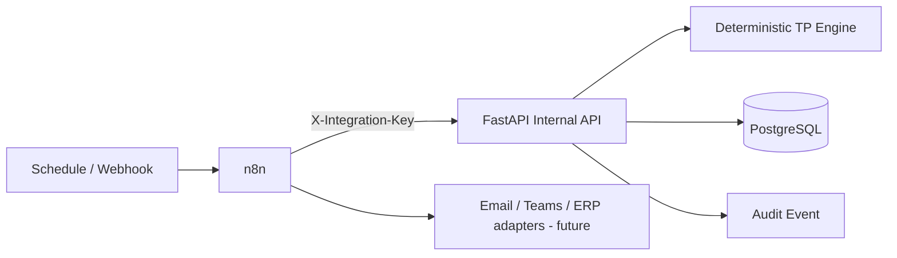

# n8n Architecture

n8n orchestrates **when / where / what next**; FastAPI owns financial truth.

The seven shipped workflow JSON files are version-controlled and contain no plaintext credential values. They reference the n8n environment integration key.
