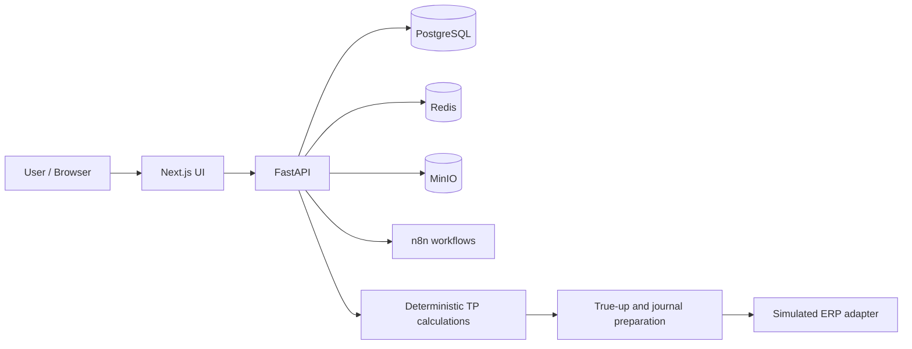

# Architecture at a glance

## Financial control path

Finance/ERP import → quality checks → account/entity mapping → allocation → P&L → policy and benchmarking → forecasts/variance → adjustment → approval → journal → **simulated** ERP posting → reconciliation and audit evidence.

## Separation of responsibilities

- **FastAPI/Python** owns accounting and transfer-pricing logic.
- **PostgreSQL** persists governed finance and workflow records.
- **Next.js** supplies the frontend for operational users.
- **n8n** orchestrates tasks; it is not the financial calculation source of truth.
- **MinIO** holds object and document storage.

This is a demonstration architecture. Production infrastructure, SSO/IdP, live SAP and external assurance remain out of scope. See `docs/EXTERNAL_QUALIFICATION_REQUIRED.md`.
