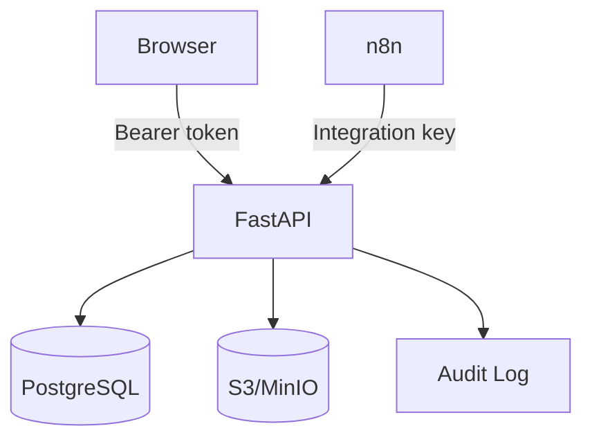

# Security Architecture

Demo authentication uses PBKDF2-SHA256 password hashing and an HMAC-signed expiring session token. Production qualification requires enterprise OIDC/SAML, MFA, tenant-scoped RLS/ABAC, TLS termination, external secrets management, CSP/export hardening and independent penetration testing.
