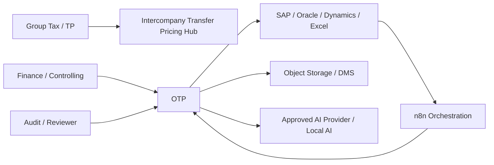

# System Context — v2.0.0-rc.1

The Intercompany Transfer Pricing Hub is the controlled execution layer between approved TP policy and accounting outcomes. File-based ERP ingestion is implemented. Live ERP write-back remains an adapter qualification boundary; v2.0.0-rc.1 ships an explicitly simulated SAP connector plus production connector contract.
